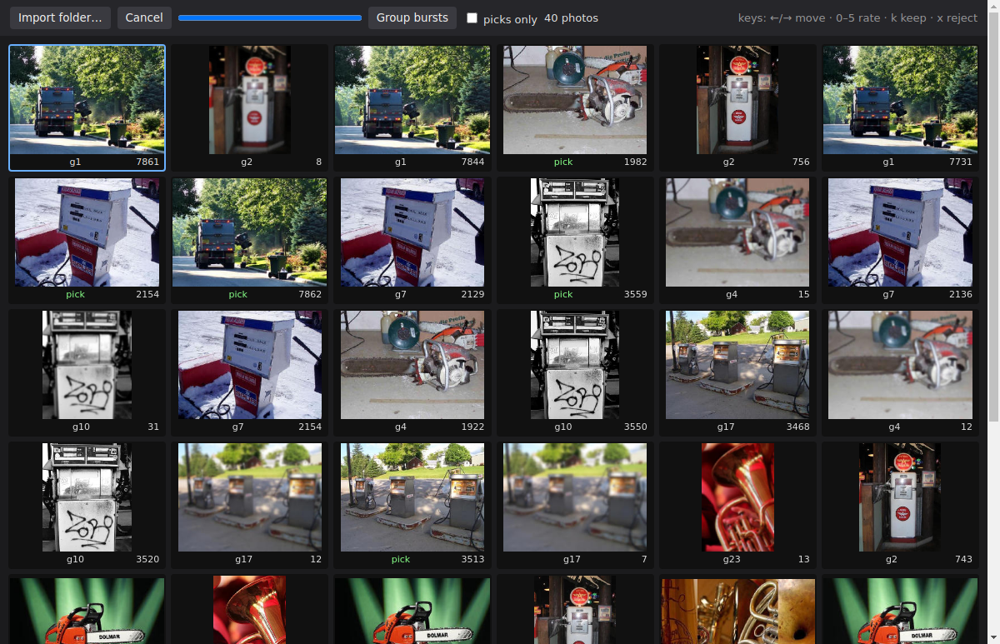

# cull-sidecar

A local Rust backend for a photo-culling desktop app. It runs as a child process beside a
minimal Electron app and owns everything heavy: decoding, thumbnails, blur scoring,
near-duplicate grouping, and the SQLite catalog. The Electron side only starts it,
checks its health, restarts it, and stops it cleanly.



*The Electron app on 40 frames (10 bursts). Bottom-right of each tile is the Laplacian-variance
sharpness score: blurred frames score 7–31, sharp ones 740–7,900. Each burst's sharpest
frame is marked `pick`.*

## What is in it

| Piece | What it does |
|---|---|
| `src/server.rs` | JSON-lines protocol: requests, replies, and streamed events (`progress`, `import_done`). It requires a versioned `hello` first, and supports cancellation and an optional auth token. One handler serves all transports. |
| `src/transport.rs` | **stdio** (default; the parent dying means EOF, so the sidecar exits), **Unix socket** (mode 0600), **loopback TCP** (`TCP_NODELAY`). |
| `src/shm.rs` | Large buffers go through a memory-mapped transfer region in `/dev/shm`, not base64 inside JSON. This is the only `unsafe` block in the crate. |
| `src/db.rs` | SQLite in WAL mode with a schema version (`PRAGMA user_version`). A newer catalog is refused, not corrupted. There is one writer connection and one read-only connection, so UI reads don't wait on import transactions. Re-importing a file never overwrites the user's ratings. |
| `src/import.rs` | Walk the folder → rayon workers (decode, thumbnail, score) → bounded channel → a single DB writer committing 256 rows per transaction. Unchanged files (same size and mtime) are skipped. |
| `src/imaging.rs` | Thumbnail cache (write-then-rename, keyed by path+size+mtime), Laplacian-variance sharpness, DCT pHash, and EXIF fields. |
| `electron/sidecar.js` | Node client plus `Supervisor`: spawn, `hello` handshake, health ping, restart with backoff after a crash or hang, and graceful stop that escalates to SIGKILL. |
| `electron/main.js` | Electron main process. The renderer is sandboxed and can only call an allowlist of methods; it cannot call `shutdown` or the benchmark methods. |

The backend uses the cores minus one by default, leaving one for the UI.

## Results

Machine: i5-9300H laptop, WSL2 (4 vCPU, 2.9 GB RAM), shared with an IDE and a browser.
Every number below comes from a file in `results/`, produced by `scripts/run_benchmarks.sh` and
`scripts/repeat_checks.sh`. **Photos:** 13,394 real photos from
[Imagenette](https://github.com/fastai/imagenette) (`imagenette2-320`, about 320×480). To get
ground truth, `gen-bursts` turns 2,000 of them into **synthetic** 4-frame bursts (8,000 frames).
Within a burst the frames differ by a small framing shift and an exposure change, and 30% are
Gaussian-blurred. The base photos are real; the bursts and blur are generated.

### Image analysis quality (`results/quality-*.json`)

| | Strong blur (σ 1.5–3) | Mild blur (σ 0.5–1) |
|---|---|---|
| Grouping at threshold 10: pairwise precision / recall | 98.5% / 99.1% | 98.5% / 98.9% |
| Blur, **one global threshold** (ROC AUC) | 0.997 | **0.858** |
| Blur, **within a burst**: is the sharpest frame unblurred? | 1327/1327 | **1300/1300** |

**Finding 1: sharpness only means something relative to the same scene.** With mild blur, one
global Laplacian threshold drops to AUC 0.86, because a sharp photo of a smooth sky scores
lower than a blurred photo of foliage. Comparing frames *within one burst* stays at 100%.
That is why the pipeline groups first and picks second.

**Finding 2: single-linkage grouping falls off a cliff.** Grouping uses union-find, so A~B and
B~C put A and C together. Raising the pHash threshold from 10 to 14 barely helps recall
(99.1→99.98%) but drops precision from 98.5% to 8.3%, and the largest "burst" grows from 8
photos to 483. At 16 it holds 7,004 of 8,000. The default stays at 10. A real product would
also gate on capture time.

### Durability: kill -9 mid-edit (`results/crash-*.json`, `tests/crash.js`)

8 concurrent editors send `set_rating`, and the sidecar is SIGKILLed at a random point
0.3–1.5 s in. This repeats 10 times, and after each restart every acknowledged edit is checked.

| Mode | Acked edits | Acked edits lost |
|---|---|---|
| Ack **after** COMMIT (shipped) | 6,483 (another run: 4,111) | **0** |
| Ack **before** COMMIT, flushed every 250 ms (deliberately unsafe control) | 405,939 | **996** (another run: 1,002) |

The control shows the test can actually detect loss. Scope: this covers *process* crashes.
`synchronous=FULL` is set for power loss, but power loss was not tested.

### Throughput, memory, SQLite batching

| Measurement | Result | File |
|---|---|---|
| Import scaling, 8,000 frames, warm cache | 1 thread **~107 img/s** (median, range 84–129) · 2 threads **~214** · 3 threads **305** · 4 threads 272 | `import_scaling.jsonl`, `scaling_repeat.jsonl` |
| Peak RSS by library size (3 threads) | 1k: **10.2 MB** · 5k: **13.6 MB** · 20k: **18.1 MB** | `memory.jsonl` |
| RSS over time, 20k import | rises 13 → 18.4 MB over the first 55 s, then flat for the last 20 s | `memory_trace_20k.txt` |
| SQLite inserts, `synchronous=FULL` | 1 row/txn **220 rows/s** → 256 rows/txn **24,070 rows/s (109×)** | `sqlite_batching.jsonl` |
| SQLite inserts, `synchronous=NORMAL` | 4,824 → 39,642 rows/s (8.2×) | same |

- 4 threads is slower than 3 on 4 vCPUs because the DB writer thread needs a core too.
- The memory growth is **not** the file list: re-importing the unchanged 20k library (no
  decoding) peaks at 10.5 MB (`memory_reimport_20k.json`). The rise during decoding is not
  attributed; the likely causes are the SQLite page cache and allocator arenas, which I did
  not verify.
- With **24 MP camera files, memory would be dominated by decode buffers** (~72 MB RGB per
  worker), so the peak would scale with thread count × frame size. That was not measured.

### IPC as Electron sees it (`results/ipc_*.json*`, `bench/ipc.js`)

Ping round trips are 20,000 sequential requests from Node, run in three different orders:

| Transport | p50 across runs | p99 across runs |
|---|---|---|
| stdio | 77–151 µs | 0.48–3.7 ms |
| Unix socket | 79–222 µs | 0.66–3.6 ms |
| loopback TCP | 100–132 µs | 0.26–4.3 ms |

**Finding 3: for small messages the transport doesn't matter.** The differences between
transports are smaller than run-to-run noise. A first run made the Unix socket look 1.7×
slower than TCP; re-running in other orders removed that.

What *does* matter is how large buffers travel:

| Buffer | base64 in JSON (p50) | shared region (p50) |
|---|---|---|
| 64 KB | 0.6–0.9 ms | 0.3–1.3 ms (no consistent win) |
| 1 MB | 10–26 ms | 0.6–1.1 ms |
| 8 MB | 92–179 ms | 3.6–5.9 ms |
| 24 MB (≈ a 6 MP RGBA preview) | 327–769 ms | 10–13 ms (**30–58×**) |

Thumbnails (~10–20 KB) therefore go by file path or base64; full-size previews would use the
shared region. On the Node side the region is read with `pread` from tmpfs, because Node can't
`mmap` without a native addon.

### Responsiveness, startup, supervision

| Measurement | Result | File |
|---|---|---|
| UI `list(50)` while importing 3,925 photos (8 runs) | p50 **0.9–1.4 ms**, p99 4.8–15.8 ms, worst single call 120 ms (idle p99 2.5–7.8 ms, one 91 ms outlier) | `ui_latency*.json*` |
| UI `set_rating` while importing (waits for import batch commits) | p50 2.7–5.8 ms, p99 13–56 ms, worst single call 380 ms | same |
| Startup, spawn → `hello` reply, 100k-photo catalog (14.6 MB) | **2.6–3.0 ms** median over 2 runs of 21 (empty catalog 2.2–2.6 ms); first page of 50: 3.3–3.9 ms | `startup.json` |
| Restart after kill -9 | **209 ms** (200 ms of that is the first backoff step) | `supervisor.json` |
| Hang (SIGSTOP) detected and restarted | **907–916 ms** (two missed 200 ms health pings) | same |
| Graceful stop (shutdown → WAL checkpoint → exit 0) | **8–11 ms** | same |

Reads stay fast during an import because WAL lets the read-only connection proceed while the
writer holds a transaction. Edits share the writer connection, so they can wait behind a
256-row batch. I also tested leaving one core free (3 vs 4 workers): it made **no consistent
difference** in 3 alternating repeats on this shared laptop, so that's a default, not a measured win.

## Running it

```bash
cargo build --release
cargo test --release                       # unit + end-to-end protocol test
CULL_BIN=target/release/cull-sidecar node --test tests/supervisor.test.js
node tests/crash.js target/release/cull-sidecar /tmp/crash --kills 10

npm install && CULL_SIDECAR_BIN=target/release/cull-sidecar npm start   # the Electron app
scripts/run_benchmarks.sh target/release/cull-sidecar /tmp/cull-work     # every number above
```

CI (`.github/workflows/ci.yml`) runs on Linux: fmt, clippy `-D warnings`, the tests, the
supervisor test, the 10-kill durability test, and a headless Electron smoke test (import →
group → list → graceful exit, under xvfb). It also builds and tests on Windows (stdio + TCP
transports and the catalog).

### Protocol in one screen

```text
→ {"id":1,"method":"hello","params":{"protocol":1}}
← {"id":1,"result":{"protocol":1,"schema":1,"photos":20000,"shm":"/dev/shm/cull-sidecar-4242.xfer",...}}
→ {"id":2,"method":"import","params":{"dir":"/photos/wedding"}}
← {"id":2,"result":{"job":1}}
← {"event":"progress","job":1,"done":512,"total":4000}
← {"event":"import_done","job":1,"stats":{"imported":4000,"skipped_unchanged":0,...}}
→ {"id":3,"method":"set_rating","params":{"id":17,"rating":4}}     // replies after COMMIT
→ {"id":4,"method":"bench_blob","params":{"len":25165824,"via":"shm"}}
← {"id":4,"result":{"len":25165824,"offset":0,"seq":1}}
```

Methods: `hello ping import cancel list set_rating set_decision group thumb bench_blob stats shutdown`.
Errors carry a code: `version_mismatch`, `hello_required`, `unauthorized`, `bad_params`, `not_found`, `unknown_method`.

## Not done / limits

- **Windows named pipe is not implemented.** On Windows, CI builds and tests only the stdio and
  TCP transports. All performance numbers are Linux (WSL2).
- **No real camera files.** No RAW and no 24 MP JPEGs; the photos are ~320 px. Decoding at
  reduced size (JPEG DCT scaling) would be the first optimisation for real files, and it isn't built.
- **The bursts and blur are synthetic**, built from real photos. Real missed focus and motion
  blur are not Gaussian.
- "HTTP/WebSocket" is raw loopback TCP with the same JSON-lines framing, not an HTTP stack.
- Process-crash durability is tested; **power loss is not**.
- No packaging. The Electron app finds the sidecar by path, with no electron-builder bundling
  and no code signing.
- Benchmarks ran on a shared laptop, so ranges are reported where the runs disagreed.
